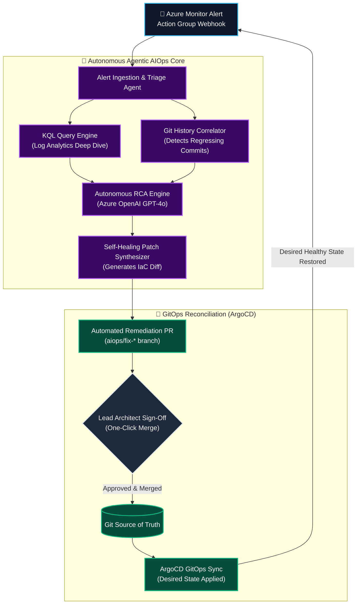

<div align="center">


<p align="center">
  
  
  
  
</p>

</div>

---

## 🧭 Overview

**Agentic AIOps Cloud Sentinel** is an enterprise-grade autonomous Site Reliability Engineering (SRE) agent designed to bridge real-time cloud observability with **GitOps automated remediation**.

When an incident triggers in Azure Monitor, the agent autonomously:
1. **Triages the Alert:** Ingests the alert schema, extracts resource IDs, and assesses severity.
2. **Executes Deep KQL Diagnostics:** Queries Azure Log Analytics to isolate error spikes, CPU/memory saturation, and failed dependency calls.
3. **Correlates Git Deployments:** Inspects recent commit history to detect regressions or misconfigured IaC parameters.
4. **Synthesizes Root-Cause Analysis (RCA):** Employs LLM agents (Azure OpenAI GPT-4o) to formulate an exact post-mortem explanation.
5. **Generates Self-Healing Pull Requests:** Submits a targeted branch and Pull Request on GitHub with a unified diff and full post-mortem for Lead approval.
6. **Reconciles Desired State:** Upon merge, **ArgoCD / GitOps operators** automatically sync and restore the production cluster to healthy state.

---

## 🔄 Autonomous Loop Architecture



---

## ⚡ Live Simulation Output (90-Second MTTR)

```
============================================================
🤖 LAUNCHING AGENTIC AIOPS SIMULATION
📂 Alert Payload: tests/fixtures/mock_azure_alert.json
============================================================
[INFO] Ingested Alert: 'High CPU & Memory Saturation' [Sev1]
[INFO] Querying Log Analytics for resource: vmss-prod-api over past 60m
[INFO] Correlating recent git commits in swapnilagarwal30/azure-enterprise-landingzone-tf
[INFO] Generated PR '🤖 [AIOps Auto-Remediation] Resolve High CPU & Memory Saturation'

============================================================
✅ AUTONOMOUS TRIAGE & REMEDIATION COMPLETED (90s MTTR)
============================================================
Incident:    Resolve High CPU & Memory Saturation on App Workload
Severity:    Sev1
PR Status:   OPEN (Awaiting Lead Architect Approval)
PR URL:      https://github.com/swapnilagarwal30/azure-enterprise-landingzone-tf/pull/42
------------------------------------------------------------
## 🚨 Autonomous Incident Mitigation Report
- Severity: Sev1
- Root Cause: Commit a7b8c9d downscaled VMSS SKU to Standard_B2s, exhausting CPU credits.
- Fix: Restoring VMSS SKU to Standard_D4s_v5 with dedicated vCPU.
```

---

## 🚀 Quickstart & Local Execution

### 1. Clone & Install
```bash
git clone https://github.com/swapnilagarwal30/agentic-aiops-cloud-sentinel.git
cd agentic-aiops-cloud-sentinel

python -m venv venv
source venv/bin/activate  # On Windows: .\venv\Scripts\activate
pip install -r requirements.txt
```

### 2. Run Local Incident Triage Simulation
```bash
python src/main.py --simulate-alert
```

### 3. Run Webhook Server
```bash
python src/main.py
# Server runs on http://0.0.0.0:8080/api/v1/azure-monitor-webhook
```

### 4. Run Unit Tests
```bash
pytest -v tests/
```

---

## 📁 Repository Structure

```
.
├── config/
│   └── config.yaml               # Model parameters, Azure OpenAI & repo settings
├── src/
│   ├── main.py                   # FastAPI server & CLI simulation entrypoint
│   ├── agent/
│   │   └── sre_agent.py          # Multi-agent SRE orchestration
│   ├── analyzers/
│   │   ├── kql_analyzer.py       # Azure Log Analytics KQL query engine
│   │   └── git_analyzer.py       # Git commit regression correlator
│   └── remediation/
│       ├── patch_synthesizer.py  # Unified diff / IaC patch generator
│       └── pr_creator.py         # PyGithub automated PR submission
├── gitops/
│   ├── argocd-application.yaml   # ArgoCD target application manifest
│   ├── reconciliation-policy.yaml# GitOps sync & prune configuration
│   └── manifests/
│       └── app-deployment.yaml   # Target Kubernetes deployment
├── tests/
│   ├── test_sre_agent.py         # Unit tests
│   └── fixtures/
│       └── mock_azure_alert.json # Azure Monitor alert schema
├── docker/
│   └── Dockerfile                # Multi-stage production container
└── requirements.txt
```

---

## 👤 Author

**Swapnil Agarwal**  
*Senior DevSecOps Engineer & Azure Cloud Architect*  
- **Email:** [swapnilagarwal94@gmail.com](mailto:swapnilagarwal94@gmail.com)  
- **GitHub:** [@swapnilagarwal30](https://github.com/swapnilagarwal30)  
- **LinkedIn:** [Swapnil Agarwal](https://www.linkedin.com/in/swapnilagarwal30/)
